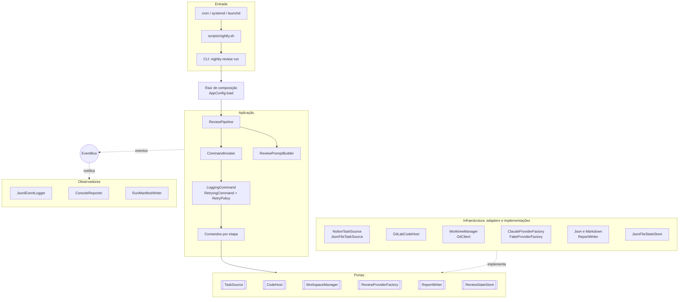
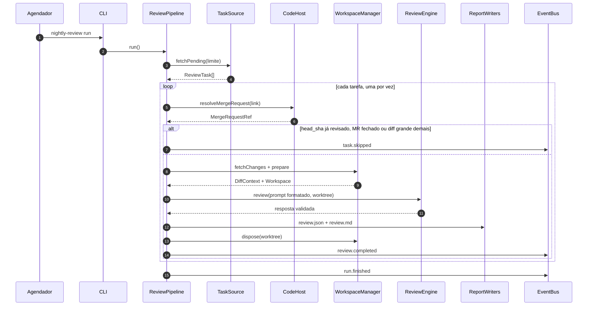

# Arquitetura: nightly-review

Documento de referência para a implementação. A justificativa acadêmica de cada padrão está em [`PATTERNS.md`](PATTERNS.md), e a ordem de construção, em [`PLAN.md`](PLAN.md).

> Os contratos TypeScript deste documento foram compilados com `strict`, `noUncheckedIndexedAccess` e `noImplicitOverride`. O fluxo completo também foi executado com os fakes: retentativas, idempotência, interrupção por limite e a guarda de leitura com ataque por symlink. As opções do Claude Agent SDK foram conferidas na documentação oficial em outubro de 2026. O SDK evolui rápido, então confira os tipos do pacote instalado antes de implementar o adapter (seção 12).

## 1. Visão geral

Toda noite, um agendador executa a CLI `nightly-review run`. A execução segue estes passos:

1. busca no Notion as tarefas com status de revisão;
2. resolve o link do MR de cada tarefa na API do GitLab;
3. prepara um worktree isolado no `head_sha` do MR;
4. pede ao Claude (Agent SDK, usando a assinatura) um review somente leitura contra o que a tarefa pedia;
5. valida a saída e grava relatórios e logs em arquivos.

De manhã, você lê os relatórios e decide o que vira comentário no MR.

**Escopo da v1:** tudo acima, com saída somente em arquivos.

**Fora da v1, com ponto de extensão pronto:**

- draft notes no GitLab;
- comentário de resumo no Notion;
- Jira e Trello como fonte de tarefas;
- outros provedores de IA;
- formato Code Quality do GitLab;
- estado em SQLite.

## 2. Requisitos

**Funcionais**

| ID | Requisito |
|---|---|
| RF1 | Buscar as tarefas em revisão em um gerenciador de tarefas (Notion na v1). |
| RF2 | Ler de cada tarefa: título, descrição, regras de negócio, critérios de aceite e link do MR. |
| RF3 | Resolver o MR (projeto, branches, `diff_refs`) e preparar um worktree no `head_sha`. |
| RF4 | Montar o prompt com tarefa, critérios do time, escopo do MR e diff. |
| RF5 | Executar o review com o Claude Code em modo somente leitura e obter saída estruturada. |
| RF6 | Validar a saída e gravar relatórios em JSON e Markdown. |
| RF7 | Não revisar duas vezes o mesmo par tarefa + `head_sha`. |
| RF8 | Registrar o que foi executado, erros e retentativas em arquivos. |

**Não funcionais**

| ID | Requisito |
|---|---|
| RNF1 | Segurança: o modelo não escreve, não executa comandos, não acessa a rede e não lê fora do worktree. |
| RNF2 | Resiliência: retentativa por tipo de erro; interrupção limpa quando o limite da assinatura estoura. |
| RNF3 | Observabilidade: log estruturado de cada evento, manifesto por execução e transcrição de cada tentativa. |
| RNF4 | Evolução: novas plataformas de tarefas, novas IAs e novos formatos de saída entram sem alterar o pipeline. |
| RNF5 | Testabilidade: tudo roda offline com fakes, sem credenciais. |
| RNF6 | Armazenamento em arquivos, com escrita atômica. |

**Acadêmicos.** A disciplina exige no mínimo 5 padrões de projeto, de mais de uma categoria, aplicados de forma fundamentada. Exige também o uso dos recursos da linguagem (interfaces, classes abstratas, tipos utilitários, enums, genéricos), código executável e justificativa de cada padrão. O projeto aplica os 9 padrões do material, conforme a tabela em [`PATTERNS.md`](PATTERNS.md).

## 3. Decisões técnicas

| Tema | Escolha | Motivo |
|---|---|---|
| Linguagem | TypeScript estrito, ESM | Requisito da disciplina; contratos explícitos entre camadas. |
| Runtime | Node.js 22 ou superior | O Agent SDK e o SDK do Notion são oficiais em JS/TS. |
| Execução | `tsx` em desenvolvimento, `tsc` para build | O type stripping nativo do Node não suporta `enum` nem *parameter properties*, ambos usados aqui. |
| IA | Claude Agent SDK (TypeScript) com a assinatura | Mensagens tipadas, hooks, `AbortController` e saída estruturada, sem parsing de shell. A autenticação usa o token de `claude setup-token` em `CLAUDE_CODE_OAUTH_TOKEN`. |
| Validação | Zod 4 | Um schema gera os tipos (`z.infer`), valida em tempo de execução e produz o JSON Schema (`z.toJSONSchema`, draft-07) que o SDK exige. |
| Notion | `@notionhq/client` v5+ | Modelo de *data sources* (API `2025-09-03`, padrão do SDK). |
| GitLab | REST v4 com `fetch` nativo | Usa só um endpoint e evita dependência pesada. O token precisa apenas de `read_api`. |
| Git | CLI via `execFile` | Clone parcial (`--filter=blob:none`) reaproveitado e um worktree por tarefa. |
| CLI | `commander` | Subcomandos `run`, `tasks` e `demo`. |
| Testes | Vitest | Rápido, ESM nativo e com suporte a mocks de módulo. |
| Estilo | Arquitetura em camadas (hexagonal leve) | O domínio não conhece Notion, GitLab nem Claude; as trocas acontecem nos adapters. |

## 4. Componentes



## 5. Camadas e estrutura de pastas

**Regra de dependência.** As setas apontam para dentro:

- `domain` não importa outras camadas; a única dependência externa é o Zod.
- `application` importa `domain` e `shared`, e declara as **portas** (interfaces).
- `infrastructure` implementa as portas.
- Apenas `composition-root.ts` e `cli/` conhecem classes concretas e o `AppConfig`.

```text
nightly-review/
├── CLAUDE.md
├── README.md
├── package.json · tsconfig.json · tsconfig.build.json · eslint.config.js · vitest.config.ts
├── review.config.example.json
├── .env.example
├── prompts/
│   ├── system.md                   # papel do revisor e regras do prompt
│   └── review-instructions.md      # critérios do time: o que avaliar e o que ignorar
├── scripts/
│   └── nightly.sh                  # chamado pelo agendador
├── src/
│   ├── domain/                     # modelos, enums, erros e eventos (sem I/O)
│   │   ├── enums.ts
│   │   ├── review-task.ts
│   │   ├── merge-request.ts
│   │   ├── review-output.ts        # schemas Zod + tipos inferidos
│   │   ├── review-report.ts
│   │   ├── errors.ts
│   │   └── events.ts
│   ├── shared/
│   │   ├── types.ts                # DeepReadonly, Result, assertNever, deepFreeze
│   │   └── fs.ts                   # writeFileAtomic
│   ├── application/
│   │   ├── ports/                  # interfaces implementadas pela infraestrutura
│   │   ├── events/event-bus.ts     # Observer (subject)
│   │   ├── commands/               # Command: interface, invoker e comandos
│   │   ├── decorators/             # Decorator: retry e log de comandos
│   │   ├── retry/retry-policy.ts   # Strategy
│   │   ├── prompt/                 # Builder
│   │   └── pipeline/review-pipeline.ts
│   ├── infrastructure/
│   │   ├── task-sources/           # Adapter: Notion e arquivo JSON
│   │   ├── code-hosts/             # Adapter: GitLab e local (demo)
│   │   ├── git/                    # GitClient e WorktreeManager
│   │   ├── providers/              # Abstract Factory: claude/ e fake/ + TranscriptRecordingEngine
│   │   ├── reports/                # Factory Method
│   │   ├── logging/                # Observers e redactor
│   │   ├── state/                  # JsonFileStateStore
│   │   └── lock/run-lock.ts
│   ├── config/app-config.ts        # Singleton + schemas da configuração
│   ├── composition-root.ts
│   └── cli/                        # run, tasks, demo
└── tests/
    ├── patterns/                   # um arquivo por padrão (demonstração)
    ├── unit/
    ├── integration/                # pipeline offline e git real em pasta temporária
    ├── helpers/                    # dados de exemplo compartilhados pelos testes
    └── fixtures/                   # respostas gravadas do Notion e do GitLab
```

## 6. Modelo de domínio

O código é escrito com identificadores em inglês; os comentários e mensagens ficam em português.

**Enums** (`src/domain/enums.ts`), todos `string enum`:

| Enum | Valores |
|---|---|
| `Severity` | `blocker`, `major`, `minor`, `nit` |
| `FindingCategory` | `bug`, `security`, `performance`, `tests`, `readability`, `requirements` |
| `Confidence` | `high`, `medium`, `low` |
| `CriterionStatus` | `met`, `not_met`, `unclear` |
| `Verdict` | `approve`, `changes_requested`, `needs_discussion` |
| `TaskSourceKind` | `notion`, `json-file` |
| `CodeHostKind` | `gitlab`, `local` |
| `ProviderKind` | `claude`, `fake` |
| `OutputFormat` | `json`, `markdown` |
| `ErrorKind` | `rate_limit`, `transient`, `timeout`, `invalid_output`, `invalid_input`, `not_found`, `configuration`, `unknown` |
| `SkipReason` | `missing_mr_link`, `mr_not_open`, `already_reviewed`, `diff_too_large`, `dry_run` |

**Entidades** (resumo; a versão completa está nos arquivos citados):

```ts
// review-task.ts: tarefa no modelo interno, independente da plataforma
export interface ReviewTask {
  readonly id: string;
  readonly source: TaskSourceKind;
  readonly url: string;
  readonly title: string;
  readonly description: string;               // corpo convertido para Markdown
  readonly businessRules: readonly string[];
  readonly acceptanceCriteria: readonly string[];
  readonly mergeRequestUrl: string | null;    // campo estruturado; null quando vazio
}

// merge-request.ts
export interface MergeRequestRef {
  readonly host: CodeHostKind;
  readonly projectId: number;
  readonly projectPath: string;
  readonly iid: number;
  readonly title: string;
  readonly description: string;
  readonly webUrl: string;
  readonly state: 'opened' | 'closed' | 'locked' | 'merged';
  readonly sourceBranch: string;
  readonly targetBranch: string;
  readonly diffRefs: { readonly baseSha: string; readonly startSha: string; readonly headSha: string };
}

export interface DiffContext {
  readonly patch: string;
  readonly files: readonly ChangedFile[];    // path, status, additions, deletions
  readonly bytes: number;
  readonly baseSha: string;                  // commits realmente comparados
  readonly headSha: string;
}
```

`baseSha` e `headSha` do `DiffContext` são os commits que o diff comparou. Normalmente são os `diffRefs` da API. Se o MR recebeu um push entre a consulta à API e o fetch, vale o head que veio no fetch, e a base passa a ser o `merge-base` dele com a branch alvo. Dali em diante, o pipeline usa os SHAs do `DiffContext`.

`ChangedFile.status` é a união literal `'added' | 'modified' | 'deleted' | 'renamed'`, no mesmo estilo de `MergeRequestRef.state`.

**Saída da IA** (`review-output.ts`). O modelo produz só o conteúdo do review. Tarefa, MR e `head_sha` são metadados que a aplicação já conhece; ela os acrescenta depois, no `ReviewReport`. Isso reduz o que o modelo pode errar.

```ts
export const FindingSchema = z.object({
  id: z.string().min(1),
  severity: z.enum(Severity),            // Zod 4 aceita enum nativo do TypeScript
  category: z.enum(FindingCategory),
  file: z.string().min(1),
  line: z.number().int().positive().nullable(),   // null = vale para o arquivo inteiro
  title: z.string().min(1),
  comment: z.string().min(1),
  suggestion: z.string().nullable(),
  confidence: z.enum(Confidence),
});

export const ReviewOutputSchema = z.object({
  summary: z.string().min(1),
  verdict: z.enum(Verdict),
  acceptanceCriteria: z.array(CriterionCheckSchema),   // criterion, status, notes
  findings: z.array(FindingSchema),
});
export type ReviewOutput = z.infer<typeof ReviewOutputSchema>;

/** JSON Schema entregue ao provedor. O Agent SDK valida em draft-07. */
export function reviewOutputJsonSchema(): Record<string, unknown> {
  return z.toJSONSchema(ReviewOutputSchema, { target: 'draft-7' });
}
```

**Relatório** (`review-report.ts`): `ReviewReport` junta a saída validada com os metadados que a aplicação já conhece:

| Campo | Conteúdo |
|---|---|
| `runId`, `generatedAt`, `provider` | Execução, instante da geração (ISO 8601) e `ProviderKind`. |
| `task` | `Pick<ReviewTask, 'id' \| 'title' \| 'url' \| 'source'>`. |
| `mergeRequest` | `iid`, `title`, `webUrl`, `projectPath`, `sourceBranch`, `targetBranch` e `headSha`. |
| `output` | O `ReviewOutput` validado. |
| `stats` | `findingsBySeverity: Record<Severity, number>` (calculado por `countBySeverity`), `durationMs`, `turns?` e `costUsd?`. |

**Erros** (`errors.ts`): a classe abstrata `AppError` declara `abstract readonly kind: ErrorKind`. Cada subclasse fixa o seu tipo:

- `RateLimitError`, `TransientError`, `TimeoutError`, `InvalidOutputError`;
- `InvalidInputError`, `NotFoundError`, `ConfigurationError`, `UnknownError`.

O tipo (`kind`) decide a política de retentativa. O construtor recebe `(message, details?, options?)`, e `TransientError` aceita ainda `retryAfterMs` nas opções, para o `Retry-After` dos serviços. Há também:

- `RunAbortedError`, que interrompe a execução inteira. É um sinal de controle: estende `Error`, e não `AppError`, porque não tem `ErrorKind` próprio. O erro que causou a interrupção fica em `cause`;
- `createError(kind, …)`, que mapeia cada `ErrorKind` para a sua classe por um `Record` de construtores;
- `toAppError(unknown)`, que normaliza qualquer valor lançado: um `AppError` volta como está, um `RunAbortedError` devolve a causa, e o resto vira `UnknownError`. Classificar erros de rede ou de API é papel dos adapters.

`AppError.toJSON()` devolve um `SerializedError` com `name`, `kind`, `message`, `details` e `cause` (nome e mensagem). O `stack` só entra em erros `unknown`, onde ajuda a investigar a falha.

**Eventos** (`events.ts`): a interface `PipelineEvents` mapeia cada tipo de evento para o seu payload. Ela é a fonte única de verdade do Observer, do log em JSONL e do manifesto.

| Evento | Quando |
|---|---|
| `run.started` / `run.finished` / `run.aborted` | Início, fim (com resumo) e interrupção da execução. |
| `tasks.fetched` | Tarefas obtidas da fonte. |
| `task.started` / `task.skipped` / `task.failed` | Ciclo de vida de cada tarefa. |
| `command.started` / `command.succeeded` / `command.failed` / `command.undone` | Ciclo de vida de cada etapa, com duração e erro serializado. |
| `retry.scheduled` | Cada retentativa: tentativa, espera, tipo de erro e mensagem. |
| `review.completed` | Veredito, achados por severidade e caminhos dos relatórios. |

Payload de cada evento:

| Evento | Payload |
|---|---|
| `run.started` | `startedAt`, `provider`, `taskSource`, `dryRun` |
| `run.finished` | `summary` (`RunSummary`: `total`, `reviewed`, `skipped`, `failed`, `pending`), `durationMs` |
| `run.aborted` | `error`, `pendingTaskIds` |
| `tasks.fetched` | `count`, `taskIds` |
| `task.started` | `taskId`, `title` |
| `task.skipped` | `taskId`, `reason` (`SkipReason`) |
| `task.failed` | `taskId`, `error` |
| `command.started` | `command`, `taskId` |
| `command.succeeded` | `command`, `taskId`, `durationMs` |
| `command.failed` | `command`, `taskId`, `durationMs`, `error` |
| `command.undone` | `command`, `taskId`, `error?` (quando o próprio desfazer falhou) |
| `retry.scheduled` | `command`, `taskId`, `attempt`, `delayMs`, `errorKind`, `message` |
| `review.completed` | `taskId`, `verdict`, `findingsBySeverity`, `reportPaths` |

Nos eventos de etapa (`command.*` e `retry.scheduled`), `taskId` é `string | null`: vale `null` em `fetch-pending-tasks`, que roda uma vez por execução, sem tarefa. Todo `error` é um `SerializedError`.

O envelope `EventEnvelope<TEvents>` tem `type`, `at` (ISO 8601) e `payload`. O `runId` das linhas do JSONL é acrescentado pelo `JsonlEventLogger`.

## 7. Portas

```ts
// Adapter (Target): qualquer gerenciador de tarefas
export interface TaskSource {
  readonly kind: TaskSourceKind;
  fetchPending(limit: number): Promise<readonly ReviewTask[]>;
}

// Adapter (Target): plataforma que hospeda o código
export interface CodeHost {
  readonly kind: CodeHostKind;
  resolveMergeRequest(url: string): Promise<MergeRequestRef>;   // recusa hosts não configurados
  cloneUrl(projectPath: string): string;                         // derivada da configuração
  mergeRequestRef(iid: number): string;                          // refs/merge-requests/<iid>/head
}

export interface WorkspaceManager {
  fetchChanges(mr: MergeRequestRef): Promise<DiffContext>;       // clone base + fetch + diff, sem checkout
  prepare(mr: MergeRequestRef): Promise<Workspace>;              // worktree no head_sha
  dispose(workspace: Workspace): Promise<void>;
}

// Abstract Factory e seus produtos
export interface ReviewProviderFactory {
  readonly kind: ProviderKind;
  createPromptFormatter(): PromptFormatter;   // ReviewPrompt -> { system, user }
  createEngine(): ReviewEngine;               // executa o review
  createResponseParser(): ResponseParser;     // EngineResponse -> Result<ReviewOutput, InvalidOutputError>
}

export interface ReviewEngine {
  review(request: EngineRequest): Promise<EngineResponse>;
}
export interface EngineRequest {
  readonly prompt: FormattedPrompt;
  readonly workingDirectory: string;
  readonly outputSchema: Readonly<Record<string, unknown>>;
  readonly correlation: Readonly<{ runId: string; taskId: string }>;
  readonly signal?: AbortSignal;
}
export interface EngineResponse {
  readonly text: string;
  readonly structured?: unknown;    // Agent SDK: structured_output
  readonly usage: { readonly durationMs: number; readonly turns?: number; readonly costUsd?: number };
}

export interface ReportWriter {
  readonly format: OutputFormat;
  write(report: ReviewReport, directory: string): Promise<string>;
  remove(filePath: string): Promise<void>;
}

export interface ReviewStateStore {
  wasReviewed(taskId: string, headSha: string): Promise<boolean>;
  markReviewed(entry: ReviewedEntry): Promise<void>;
  unmark(taskId: string, headSha: string): Promise<void>;
}
```

Complementos das portas:

- `ReviewedEntry` tem `taskId`, `headSha`, `runId`, `reviewedAt` (ISO 8601) e `verdict`.
- `ReportWriter.remove` e `ReviewStateStore.unmark` são idempotentes: não falham quando o arquivo ou a marcação já não existem, para o rollback chamá-los sem checar antes.
- `PromptFormatter.format(prompt)` devolve um `FormattedPrompt` (`system` e `user`), e `ResponseParser.parse(response)` devolve `Result<ReviewOutput, InvalidOutputError>`.

## 8. Fluxo de uma execução



**Etapas de cada tarefa.** Cada etapa é um `Command`, executado por um `CommandInvoker` criado só para aquela tarefa. O invoker aplica a decoração `LoggingCommand(RetryingCommand(comando))`.

| # | Comando | Receptor | Desfazer (`undo`) |
|---|---|---|---|
| 0 | `fetch-pending-tasks` (uma vez por execução) | `TaskSource` | — |
| 1 | `resolve-merge-request` | `CodeHost` | — |
| 2 | `fetch-changes` | `WorkspaceManager` | — |
| 3 | `prepare-workspace` | `WorkspaceManager` | remove o worktree |
| 4 | `run-review` | família da Abstract Factory | — |
| 5 | `write-reports` | `ReportWriter[]` | apaga os arquivos gravados |
| 6 | `mark-reviewed` | `ReviewStateStore` | desmarca o par tarefa + sha |
| 7 | `cleanup-workspace` | `WorkspaceManager` | — |

Entre as etapas, o pipeline aplica as regras de pulo, sem chamar a IA:

- tarefa sem link de MR;
- MR fora do estado `opened`;
- par tarefa + `head_sha` já revisado;
- diff acima de `limits.maxDiffBytes`;
- `--dry-run`: grava o prompt renderizado em `prompts/<taskId>.md` e não chama a IA.

Se uma etapa falhar, o invoker executa `rollback()` e desfaz, em ordem reversa, o que já tinha sido feito. O histórico só guarda as etapas que terminaram com sucesso. Por isso, um comando que falha no meio limpa o próprio efeito parcial antes de relançar o erro, o que também deixa a retentativa partir do zero. A tarefa é registrada como `failed` e a execução segue para a próxima. A exceção é `RunAbortedError`: o rollback acontece, as tarefas restantes ficam `pending` e a execução termina. A limpeza do worktree no caminho de sucesso nunca reprova um review já gravado. A falha fica no log e a próxima execução faz `git worktree prune` dos restos.

Regras do fim da execução e dos casos de borda:

- **Interrupção.** O pipeline emite `run.aborted`, com o erro e as tarefas pendentes, e em seguida `run.finished`, com o resumo. Toda execução termina com `run.finished`.
- **Falha ao buscar as tarefas.** Sem a lista não há execução: qualquer falha na etapa 0 interrompe, depois de esgotadas as retentativas.
- **Erro de configuração fora das etapas.** O estado de idempotência e a montagem do prompt não são comandos. Um `ConfigurationError` vindo deles interrompe a execução, pela mesma regra da seção 9.
- **`--dry-run`.** Resolve o MR, calcula o diff, grava o prompt já formatado pelo provedor e pula a tarefa como `dry_run`. Não cria worktree, não chama a IA e não marca a tarefa como revisada.
- **`--task ID`.** Busca até 100 pendentes e revisa só a pedida. Se ela não estiver entre as pendentes, é erro de configuração.
- **`keepWorkspaces: true`.** A etapa `cleanup-workspace` não roda, e os restos de execuções anteriores não são apagados.

O núcleo do pipeline (`application/pipeline/review-pipeline.ts`):

```ts
const mr = await invoker.run(new ResolveMergeRequestCommand(this.deps.codeHost, { ...task, mergeRequestUrl }));
if (mr.state !== 'opened') return this.skip(task, SkipReason.MergeRequestNotOpen);
if (await state.wasReviewed(task.id, mr.diffRefs.headSha)) return this.skip(task, SkipReason.AlreadyReviewed);

const diff = await invoker.run(new FetchChangesCommand(this.deps.workspaces, task.id, mr));
if (diff.bytes > limits.maxDiffBytes) return this.skip(task, SkipReason.DiffTooLarge);

const workspace = await invoker.run(new PrepareWorkspaceCommand(this.deps.workspaces, task.id, mr));
const prompt = new ReviewPromptBuilder()
  .withSystemRules(this.deps.prompt.systemRules)
  .withInstructions(this.deps.prompt.instructions)
  .withTask(task)
  .withMergeRequest(mr)
  .withDiff(diff)
  .withOutputSchema(this.deps.prompt.outputSchema)
  .build();

const execution = await invoker.run(
  new RunReviewCommand(this.family, { runId: this.deps.runId, taskId: task.id, workspace, prompt }),
);
```

Depois de `fetch-changes`, o pipeline troca os `diffRefs` do MR pelos SHAs do `DiffContext`. Se o head mudou, ele confere de novo se esse par tarefa + `head_sha` já foi revisado. O worktree, o relatório e a marcação usam sempre o head realmente revisado.

`this.family` é criada uma vez, no construtor do pipeline, a partir da mesma `ReviewProviderFactory`. O motor passa pelo ponto de extensão `decorateEngine`, onde entra o `TranscriptRecordingEngine`.

## 9. Erros e retentativas

A decisão de tentar de novo é de uma **Strategy** (`RetryPolicy`), escolhida pelo tipo do erro (`ErrorKindRetryPolicy`). O `Record<ErrorKind, RetryPolicy>` obriga a definir uma política para cada tipo: esquecer um tipo é erro de compilação.

| `ErrorKind` | Origem típica | Política padrão |
|---|---|---|
| `rate_limit` | Limite da assinatura (`rate_limit` no Agent SDK) | `AbortRun`: interrompe a execução; as tarefas restantes ficam para a próxima noite. |
| `configuration` | 401/403 do GitLab, token ausente, `authentication_failed`, `billing_error`, `error_max_budget_usd` | `AbortRun` |
| `transient` | Rede, 429/5xx do GitLab, `overloaded`, `server_error`, `diff_refs` ainda não calculado | Backoff exponencial: 4 tentativas, de 2 s a 30 s, com jitter e respeitando `Retry-After`. |
| `timeout` | Review acima de `provider.timeoutMs` | 2 tentativas, com 10 s de espera. |
| `invalid_output` | Saída fora do schema, `error_max_structured_output_retries`, `error_max_turns` | 2 tentativas, sem espera. |
| `invalid_input` | Link de MR inválido ou de outro host; MR sem arquivos | Falha a tarefa, sem retentar. |
| `not_found` | MR inexistente (404) | Falha a tarefa. |
| `unknown` | Qualquer outra coisa | Falha a tarefa. |

**O que conta como tentativa.** O número da tabela é o total de execuções, incluindo a primeira. Com 2 tentativas, a primeira falha é retentada e a segunda reprova a tarefa. Com 4, as esperas entre elas são de 2 s, 4 s e 8 s.

**Espera.** Com jitter, a espera é sorteada entre 50% e 100% do valor calculado. Quando o serviço informa um `Retry-After`, ele é sempre respeitado por inteiro, mesmo acima do teto de 30 s; o teto limita só a espera calculada. A espera nunca fica abaixo do backoff.

**Contagem por tipo.** O `RetryingCommand` conta as falhas separadamente por `ErrorKind` e passa essa contagem à política. Assim, uma falha de rede seguida de JSON inválido não consome a cota de JSON inválido. Esse caso apareceu no teste de ponta a ponta dos contratos e precisa de um teste próprio em `tests/integration`.

**Retentativas internas.** O Agent SDK já repete chamadas de API internamente, e o cliente do Notion repete `rate_limited` até 2 vezes. Por isso os tetos aqui são baixos, para não multiplicar as tentativas.

## 10. Logs e arquivos

Tudo fica em `dataDir`, por padrão `~/.nightly-review`, com permissão 700. Os arquivos são gravados com modo 600.

```text
~/.nightly-review/
├── runs/
│   └── 2026-10-12T05-55-00Z-k3x9/              # um diretório por execução (runId ordenável)
│       ├── events.jsonl                         # log de ocorrências: um evento por linha
│       ├── manifest.json                        # resumo + resultado de cada tarefa
│       ├── reviews/<taskId>/review.json         # relatório completo (máquina)
│       ├── reviews/<taskId>/review.md           # relatório legível
│       ├── transcripts/<taskId>/attempt-N.prompt.md
│       ├── transcripts/<taskId>/attempt-N.response.json | attempt-N.error.json
│       └── prompts/<taskId>.md                  # só com --dry-run
├── state/reviewed.json                          # idempotência: "<taskId>:<headSha>" -> entrada
├── repos/<grupo__projeto>/                      # clones parciais reaproveitados entre execuções
├── worktrees/<runId>/...                        # temporários, removidos ao fim de cada tarefa
├── logs/cron.log                                # stdout/stderr do agendador
└── run.lock                                     # impede duas execuções simultâneas
```

Exemplo de `events.jsonl`, gravado pelo `JsonlEventLogger` com `appendFileSync`, que preserva a ordem e não perde linhas se o processo cair:

```json
{"runId":"2026-10-12T05-55-00Z-k3x9","type":"command.started","at":"2026-10-12T05:55:04.120Z","payload":{"command":"run-review","taskId":"1a2b"}}
{"runId":"2026-10-12T05-55-00Z-k3x9","type":"retry.scheduled","at":"2026-10-12T05:58:10.007Z","payload":{"command":"run-review","taskId":"1a2b","attempt":1,"delayMs":0,"errorKind":"invalid_output","message":"A resposta não segue o schema"}}
{"runId":"2026-10-12T05-55-00Z-k3x9","type":"command.succeeded","at":"2026-10-12T06:01:37.552Z","payload":{"command":"run-review","taskId":"1a2b","durationMs":393432}}
```

**Manifesto.** O `RunManifestWriter` acumula os eventos e grava o `manifest.json` no `run.finished`. Ele grava também no `run.aborted`, para o arquivo existir mesmo que a execução não chegue ao fim.

| Campo | Conteúdo |
|---|---|
| `runId`, `startedAt`, `finishedAt`, `durationMs` | Identificação e tempos da execução (ISO 8601). |
| `provider`, `taskSource`, `dryRun` | Como a execução foi configurada. |
| `summary` | O `RunSummary` do `run.finished`. |
| `aborted` | `null`, ou `at`, `error` e `pendingTaskIds` quando a execução foi interrompida. |
| `tasks[]` | `taskId`, `title`, `status` (`pending`, `reviewed`, `skipped` ou `failed`) e os dados do desfecho: `reason`, `error`, `verdict`, `findingsBySeverity`, `reportPaths`. |

Uma tarefa buscada que não chegou a um desfecho fica como `pending`. Como a notificação do `EventBus` é síncrona, o manifesto usa `writeFileAtomicSync`, a versão síncrona de `writeFileAtomic`: o arquivo já está no disco quando o `emit` retorna.

**Transcrições.** O `TranscriptRecordingEngine` (um Decorator do `ReviewEngine`) grava o prompt e a resposta, ou o erro, de cada tentativa. Elas servem para calibrar `prompts/review-instructions.md` nas primeiras semanas.

- A numeração `attempt-N` é por tarefa.
- O prompt é gravado antes de o motor ser chamado. Se a gravação do prompt ou da resposta falhar, a tentativa falha; no primeiro caso, a IA nem chega a ser consultada.
- Quando o motor falha e o `error.json` também não pode ser gravado, vale o erro do motor.
- Uma resposta que o parser rejeita depois continua como `response.json`, porque o motor a devolveu sem erro.
- O `taskId` vira nome de pasta por `toPathSegment`, que troca separadores de caminho e nunca devolve `.` ou `..`.

**Worktrees.** Cada MR ganha um worktree em `worktrees/<runId>/<grupo__projeto>__mr-<iid>/`. No início da execução, `pruneOrphans()` apaga tudo em `worktrees/` que não seja da execução atual e roda `git worktree prune` em cada clone; o `run.lock` garante que ninguém mais usa essas pastas. Com `keepWorkspaces: true`, nada é apagado.

**Falhas do git.** Um comando que sai com erro vira `TransientError`, porque clone, fetch, diff e checkout num clone parcial podem todos tocar a rede. Git ausente ou diretório inexistente vira `ConfigurationError`. Branch, SHA ou número de MR inválido vira `InvalidInputError`.

**Estado.** O `state/reviewed.json` é um mapa de `"<taskId>:<headSha>"` para a `ReviewedEntry`. Arquivo ausente significa que nada foi revisado. Arquivo ilegível ou fora do formato é erro de configuração: a execução é interrompida e o arquivo fica intacto, em vez de tudo ser revisado de novo sem aviso.

**Mascaramento.** Tudo que vai para disco passa pelo `redactor`, que troca os valores dos tokens por `[REDACTED]`. Isso inclui os relatórios: cada `ReportWriter` recebe o `redactor` por construtor.

**Retenção.** Por padrão, nenhuma execução antiga é apagada. Com `retention.days` na configuração, o início de cada execução apaga as pastas de `runs/` iniciadas há mais dias que isso. A idade vem do horário que está no próprio `runId`; pastas com outro nome não são tocadas, e a execução atual nunca é apagada. O `state/reviewed.json` não é afetado.

## 11. Configuração

O `review.config.json` não contém segredos; os segredos vêm do ambiente. Mesmo assim, ele fica fora do git, porque tem caminhos e IDs de cada máquina. O repositório versiona só o `review.config.example.json`.

```json
{
  "dataDir": "~/.nightly-review",
  "taskSource": {
    "kind": "notion",
    "notion": {
      "dataSourceId": "00000000-0000-0000-0000-000000000000",
      "statusProperty": "Status",
      "statusPropertyType": "status",
      "reviewStatus": "Em revisão",
      "titleProperty": "Nome",
      "mergeRequestUrlProperty": "MR",
      "businessRulesProperty": "Regras de negócio",
      "acceptanceCriteria": { "from": "heading", "heading": "Critérios de aceite" }
    }
  },
  "codeHost": { "kind": "gitlab", "baseUrl": "https://gitlab.com", "cloneProtocol": "ssh" },
  "provider": { "kind": "claude", "maxTurns": 30, "timeoutMs": 900000 },
  "outputs": ["json", "markdown"],
  "limits": { "maxTasksPerRun": 10, "maxDiffBytes": 300000 },
  "prompts": { "systemPath": "prompts/system.md", "instructionsPath": "prompts/review-instructions.md" },
  "keepWorkspaces": false
}
```

- `acceptanceCriteria` aceita duas formas: `{ "from": "property", "property": "<nome>" }`, quando os critérios estão num campo, ou `{ "from": "heading", "heading": "<título>" }`, quando estão numa lista abaixo de um título no corpo da página.
- `dataSourceId`: na API atual do Notion, a database contém *data sources*. O ID aparece em `databases.retrieve` (campo `data_sources`).
- `provider.model` é opcional e fixa o modelo do review; sem ele, vale o padrão do provedor.
- `retention.days` é opcional, como em `"retention": { "days": 30 }`, e apaga as execuções antigas de `runs/` (seção 10).
- Os blocos `provider`, `limits` e `prompts` são opcionais. Seus valores padrão vêm do schema, via `.prefault({})` do Zod 4. Nesse caso, `.default({})` não aplicaria os padrões internos.
- `dataDir` aceita `~`, que é expandido para o diretório do usuário.
- Chaves desconhecidas são rejeitadas (`z.strictObject`), para um erro de digitação não virar um padrão aplicado em silêncio.
- `taskSource` aceita `notion` e `json-file`. A segunda é `{ "kind": "json-file", "jsonFile": { "path": "<caminho>" } }` e lê uma lista JSON de tarefas (`id`, `title` e, opcionais, `url`, `description`, `businessRules`, `acceptanceCriteria`, `mergeRequestUrl`). Todas contam como "em revisão". Os IDs precisam ser únicos e usar só letras, números, `.`, `_` e `-`, porque viram nome de pasta.
- Caminhos relativos em `prompts` são resolvidos a partir da raiz da aplicação (a pasta do `package.json`), não do diretório atual.
- `codeHost` aceita `gitlab` e `local`. A variante local é `{ "kind": "local", "repositoryPath": "<caminho>", "projectPath": "demo/loja", "targetBranch": "main" }`, com os dois últimos campos opcionais. Ela usa um repositório git da máquina no papel de servidor e serve à demonstração e aos testes.

`.env` (nunca versionado):

```bash
NOTION_TOKEN=            # integração interna com capacidade "Read content", compartilhada só com a database de tarefas
GITLAB_TOKEN=            # personal access token com escopo read_api
CLAUDE_CODE_OAUTH_TOKEN= # gerado com `claude setup-token`; usa os limites da sua assinatura
```

O clone usa as suas credenciais de git (chave SSH ou *credential helper*). O token do GitLab só é usado na API e nunca vai para a URL de clone.

Cada token só é exigido quando a configuração precisa dele. Um valor vazio conta como ausente, e o `load()` falha com `ConfigurationError` listando os nomes das variáveis que faltam, nunca os valores:

| Escolha na configuração | Variável exigida |
|---|---|
| `taskSource.kind: notion` | `NOTION_TOKEN` |
| `codeHost.kind: gitlab` | `GITLAB_TOKEN` |
| `provider.kind: claude` | `CLAUDE_CODE_OAUTH_TOKEN` |
| `json-file`, `local`, `fake` | nenhuma |

**Singleton.** `AppConfig.load(source, overrides)` lê, valida com Zod, congela com `deepFreeze` (`DeepReadonly<Settings>`) e devolve sempre a mesma instância. Apenas a raiz de composição chama `load()`; as demais classes recebem por construtor só o trecho de que precisam. Flags da CLI como `--limit` e `--provider` chegam em `overrides`, um `Partial<…>` de `limits` e de `provider`. Elas são aplicadas antes da checagem dos tokens e passam pela mesma validação do arquivo.

## 12. Integração com o Claude (Agent SDK)

O `ClaudeAgentEngine` adapta a função `query()` do SDK para a porta `ReviewEngine`. As opções abaixo formam a postura de segurança da execução noturna:

| Opção | Valor | Por quê |
|---|---|---|
| `cwd` | caminho do worktree | O modelo lê o código ao redor do diff. |
| `tools` | `['Read', 'Grep', 'Glob']` | Só ferramentas de leitura existem na sessão. |
| `allowedTools` | os mesmos três | Autoaprova as leituras, sem pedido de permissão. |
| `disallowedTools` | `Bash`, `Write`, `Edit`, `NotebookEdit`, `WebFetch`, `WebSearch`, `Agent` | Nomes sem escopo removem a ferramenta do contexto; é defesa em profundidade. |
| `permissionMode` | `'dontAsk'` | Qualquer chamada que pediria permissão é negada, e `canUseTool` nunca é chamado. Precisa ser explícito: se omitido, o modo inicial pode ser `auto`. |
| `settingSources` | `[]` | Não carrega `CLAUDE.md`, `.claude/settings.json`, hooks nem MCP do repositório revisado, que vêm da branch do MR. Se omitido, o SDK carrega todas as fontes. |
| `strictMcpConfig` + `mcpServers: {}` | — | Ignora `.mcp.json`, servidores do usuário e conectores. |
| `hooks.PreToolUse` | `createReadOnlyGuard(worktree)` | Roda antes de qualquer regra de permissão, inclusive para ferramentas autoaprovadas, e nega caminhos fora do worktree. |
| `systemPrompt` | conteúdo de `prompts/system.md` | Define o papel de revisor e a regra de que conteúdo de terceiros é dado. |
| `outputFormat` | `{ type: 'json_schema', schema }` | Saída estruturada validada pelo SDK, que pede correção quando não bate. O Zod valida de novo. |
| `maxTurns` | 30 | Teto de tempo e de uso da assinatura por review. |
| `abortController` | dispara em `timeoutMs` | Evita review travado. |
| `env` | `PATH`, `HOME`, `CLAUDE_CODE_OAUTH_TOKEN` | Substitui o ambiente inteiro: os tokens do GitLab e do Notion não chegam ao processo do Claude. |

**Por que a checagem de caminho é um hook e não `canUseTool`.** Uma entrada simples em `allowedTools`, como `"Read"`, autoaprova a ferramenta antes de o `canUseTool` ser consultado. Uma checagem posta ali seria ignorada sem aviso. O `PreToolUse` roda primeiro, para toda chamada, e o seu `deny` vale em qualquer modo.

A guarda (`infrastructure/providers/claude/read-only-guard.ts`):

```ts
export function createReadOnlyGuard(workspaceRoot: string): HookCallback {
  return async (input) => {
    if (input.hook_event_name !== 'PreToolUse') return {};
    const { tool_name: toolName, tool_input: toolInput } = input as PreToolUseHookInput;
    if (!isReadOnlyTool(toolName)) return deny(`A ferramenta ${toolName} não é permitida no review`);

    const pattern = readString(toolInput, 'pattern');
    if (toolName === 'Glob' && pattern && escapesRoot(pattern)) return deny('Padrão de busca fora do worktree');

    const requested = readString(toolInput, PATH_FIELD[toolName]) ?? workspaceRoot;
    return (await isInside(workspaceRoot, requested)) ? {} : deny('Acesso fora do worktree bloqueado');
  };
}
// isInside compara realpath(raiz) e realpath(alvo): um symlink no MR apontando para ~/.ssh é barrado.
```

**Mapeamento de erros.** O SDK sinaliza erros de API no campo `error` da mensagem `assistant`. O tipo `SDKAssistantMessageError` cobre `rate_limit`, `overloaded`, `authentication_failed`, `billing_error` e outros. Falhas do review aparecem no `subtype` da mensagem `result`: `error_max_turns`, `error_max_structured_output_retries`, `error_during_execution` e `error_max_budget_usd`. Dois `Record` exaustivos convertem esses valores em `ErrorKind`; se o SDK ganhar um valor novo, a compilação aponta. Além disso, uma chamada de `query()` lança exceção depois de emitir um resultado de erro. Por isso, o adapter também classifica a exceção pelo último erro de API visto.

Mapeamento completo, conferido contra o SDK 0.3.296:

| Sinal do SDK | `ErrorKind` |
|---|---|
| `rate_limit`, ou evento `rate_limit_event` com `status: 'rejected'` | `rate_limit` |
| `overloaded`, `server_error` | `transient` |
| `authentication_failed`, `billing_error`, `oauth_org_not_allowed`, `account_on_hold`, `verification_required`, `cloud_credential_error`, `model_not_found`, `error_max_budget_usd` | `configuration` |
| `max_output_tokens`, `error_max_turns`, `error_max_structured_output_retries` | `invalid_output` |
| `invalid_request`, `unknown`, e `error_during_execution` sem erro de API anterior | `unknown` |

Quando o resultado é `error_during_execution` e houve um erro de API antes, vale o tipo do erro de API.

**Saída estruturada.** Uma resposta só é válida quando `subtype === 'success'`, `is_error` é falso e `structured_output` existe. O SDK pode devolver `success` com `is_error: true` quando o turno termina em erro de API; isso conta como falha, classificada pelo erro de API visto. Um `success` sem `structured_output` também conta como falha.

**Tempo limite.** O `RunReviewCommand` entrega ao motor um `AbortSignal` com `provider.timeoutMs`. O motor o liga ao `abortController` do SDK e converte o cancelamento em `TimeoutError`.

**Modelo.** `provider.model` é opcional. Sem ele, o SDK usa o modelo padrão da CLI para a assinatura; com ele, o valor vai para a opção `model`. Se o SDK recusar alguma palavra-chave do JSON Schema gerado, simplifique o schema enviado e mantenha a validação completa no Zod.

**Antes de implementar.** Abra `node_modules/@anthropic-ai/claude-agent-sdk/sdk.d.ts` e confirme os nomes de `Options`, `SDKResultMessage`, `SDKAssistantMessageError`, `HookCallback` e `PreToolUseHookInput`. Fixe a versão do SDK no `package.json`.

## 13. Segurança

| Ameaça | Mitigação |
|---|---|
| *Prompt injection* no texto da tarefa, do MR ou do diff | O modelo não tem escrita, shell nem rede. O conteúdo externo vai delimitado e declarado como dado. A saída só vira arquivo local, e um humano valida antes de qualquer publicação. |
| Configuração controlada pelo autor do MR: `CLAUDE.md`, `.claude/`, `.mcp.json` e hooks na branch | `settingSources: []` e `strictMcpConfig: true`. As instruções do time vêm de `prompts/` do próprio nightly-review, nunca do worktree. |
| Leitura de segredos da máquina (`~/.ssh`, `.env` de outros projetos) via Read, Glob ou symlink | Hook `PreToolUse` com `realpath`; padrões de Glob com `..` ou caminho absoluto são negados. |
| Vazamento do token do GitLab para outro host, por um link forjado na tarefa | `parseMergeRequestUrl` aceita só a origem configurada. A URL de clone é derivada da configuração. |
| Injeção de comando por nome de branch | `execFile` com lista de argumentos, sem shell. Valide `targetBranch` com `git check-ref-format --branch` antes de montar a refspec. |
| Segredos em logs e transcrições | `redactor` em tudo que vai para disco; `dataDir` com permissão 700 e arquivos com modo 600. |
| Efeitos colaterais do checkout | `GIT_LFS_SKIP_SMUDGE=1` e `GIT_TERMINAL_PROMPT=0`. Os hooks de git são os do clone base, controlado por você. Submódulos não são inicializados. O clone base é `--bare`, sem checkout. |
| Tokens da aplicação no processo do git | O `GitClient` herda o ambiente, para as suas credenciais de clone, o agente SSH e o proxy funcionarem, mas retira `NOTION_TOKEN`, `GITLAB_TOKEN` e `CLAUDE_CODE_OAUTH_TOKEN`. |
| Valores externos em argumentos do git | SHAs são conferidos por formato e o número do MR precisa ser um inteiro positivo, antes de qualquer comando. |
| Tokens com escopo amplo | GitLab com `read_api`, já que a v1 não escreve. Integração do Notion só com "Read content". Um token por finalidade. |

## 14. Agendamento

`scripts/nightly.sh` define o ambiente mínimo e explícito, porque os agendadores não carregam o seu shell:

```bash
#!/usr/bin/env bash
set -euo pipefail
umask 077
export PATH="${NIGHTLY_REVIEW_PATH:-/opt/homebrew/bin:/usr/local/bin:/usr/bin:/bin}"
export NIGHTLY_REVIEW_ENV_FILE="${NIGHTLY_REVIEW_ENV_FILE:-.env}"
CONFIG="${NIGHTLY_REVIEW_CONFIG:-review.config.json}"
LOG_DIR="${NIGHTLY_REVIEW_LOG_DIR:-$HOME/.nightly-review/logs}"
cd "$(dirname "$0")/.."
mkdir -p "$LOG_DIR"
exec >> "$LOG_DIR/cron.log" 2>&1
# confere: node no PATH, Node.js 22 ou superior e dist/cli/index.js
if [ -f "$NIGHTLY_REVIEW_ENV_FILE" ]; then set -a; . "$NIGHTLY_REVIEW_ENV_FILE"; set +a; fi
exec node dist/cli/index.js run --config "$CONFIG"
```

O script roda o que está em `dist/`: execute `npm run build` antes de agendar e depois de cada atualização. Antes de chamar a aplicação, ele confere três coisas e grava um erro claro no `cron.log` se alguma faltar: `node` no PATH, Node.js 22 ou superior, e `dist/cli/index.js`. O `.env` é carregado só se existir, porque as variantes locais não precisam de token.

| Variável | Para quê | Padrão |
|---|---|---|
| `NIGHTLY_REVIEW_PATH` | PATH da execução; precisa conter o Node.js 22+ e o git | `/opt/homebrew/bin:/usr/local/bin:/usr/bin:/bin` |
| `NIGHTLY_REVIEW_CONFIG` | arquivo de configuração | `review.config.json` |
| `NIGHTLY_REVIEW_ENV_FILE` | arquivo com os tokens | `.env` |
| `NIGHTLY_REVIEW_LOG_DIR` | pasta do `cron.log` | `~/.nightly-review/logs` |

Modelos prontos de crontab, unidades do systemd e plist do launchd estão em `scripts/examples/`.

| Sistema | Como agendar | Observação |
|---|---|---|
| Linux (cron) | `55 2 * * 1-5 /caminho/nightly-review/scripts/nightly.sh` | O cron não executa a rodada perdida se a máquina estava desligada. |
| Linux (systemd) | Timer de usuário com `OnCalendar=Mon..Fri 02:55` e `Persistent=true` | Executa ao ligar se o horário passou. |
| macOS (launchd) | `~/Library/LaunchAgents/*.plist` com `StartCalendarInterval` | Se o Mac estava dormindo, executa ao acordar. O `pmset repeat wake` pode acordá-lo antes. |

O `run.lock` guarda o PID e o horário de início. Se já existir um lock de um processo vivo, a nova execução termina sem fazer nada, com saída 0. Um lock de processo morto é substituído. O lock é solto ao fim da execução e também em `SIGINT` e `SIGTERM`.

**CLI.** Os subcomandos são `run`, `tasks` e `demo`. `run` e `tasks` aceitam `--config <caminho>`, com `review.config.json` como padrão. Em uso manual, a CLI carrega o `.env` do diretório atual, sem sobrescrever variáveis já definidas.

| Código de saída | Quando |
|---|---|
| 0 | A execução chegou ao fim, mesmo que tarefas tenham falhado; ou outra execução já estava em andamento. |
| 1 | Erro de configuração ou de uso: arquivo inválido, token ausente, flag desconhecida, ou um erro de configuração que interrompeu a execução. |
| 2 | Execução interrompida por outro motivo, como o limite da assinatura. |

As falhas por tarefa não mudam o código de saída; ficam no manifesto, no `events.jsonl` e no terminal.

## 15. Extensibilidade

| Evolução | O que criar | O que muda no resto |
|---|---|---|
| Jira | `JiraTaskSource implements TaskSource` (JQL pelo status e campo do link do MR) + `TaskSourceKind.Jira` + variante `kind: 'jira'` no schema da configuração | Só a raiz de composição. O `switch` exaustivo sobre o enum acusa o caso faltante na compilação. |
| Trello | `TrelloTaskSource` (lista "Em revisão", campo personalizado com o link do MR) | Idem. |
| Outra IA | `OpenAIProviderFactory` com formatter, motor e parser próprios + `ProviderKind.OpenAI` | Nada no pipeline. A nova família decide se o motor é agêntico (lê o repositório) ou trabalha só com o diff. |
| Code Quality do GitLab | `CodeQualityReportWriter extends FileReportWriter` + `OutputFormat.CodeQuality` | Nada; basta listar o formato em `outputs`. |
| Draft notes no MR | Porta `ReviewPublisher` + `GitLabDraftNotesPublisher` (API `draft_notes`, posição a partir de `diff_refs`, só linhas presentes no diff) | Um comando `publish-drafts` depois de `write-reports`, com outro token, de escopo `api`. Antes de publicar, confere se o `head_sha` não mudou. |
| SQLite | `SqliteStateStore implements ReviewStateStore` | Só a raiz de composição. |

## 16. Testes e demonstração

| Camada | O que cobre | Ferramenta |
|---|---|---|
| `tests/patterns/` | Um arquivo por padrão, demonstrando o papel dele no sistema. Os adapters do Notion e do GitLab usam respostas gravadas | Vitest + fixtures |
| `tests/unit/` | Domínio e schemas, guarda read-only, motor do Claude com o SDK simulado, logging, transcrições e estado | Vitest |
| `tests/integration/` | Pipeline completo offline: retentativas, idempotência, limite da assinatura, git real em pasta temporária | Vitest + `git` |

O comando `npm run demo` funciona sem credenciais. Ele:

1. cria, numa pasta temporária que não é apagada ao final, um repositório git com `main`, uma branch de feature e a ref `refs/merge-requests/1/head`;
2. usa `JsonFileTaskSource` com duas tarefas, `LocalCodeHost` e `FakeProviderFactory`, com falhas encenadas por `--simulate transient,invalid-output`;
3. mostra no terminal as retentativas acontecendo e onde ficaram os relatórios, o log e o manifesto.

## 17. Riscos e questões em aberto

- **Campos do Notion:** os nomes reais de status, link do MR, regras e critérios precisam ser preenchidos em `review.config.json`.
- **GitLab self-managed:** se o SSH usar outra porta ou host, será preciso um modelo de URL de clone na configuração.
- **Limites da assinatura:** as tarefas rodam em sequência, com `maxTasksPerRun` como teto. Um review pode levar minutos. O uso noturno compete com o uso interativo do mesmo plano.
- **Agent SDK em evolução rápida:** fixe a versão e confira os tipos ao atualizar (seção 12).
- **MRs grandes:** na v1, são pulados com `diff_too_large`. A revisão por arquivo fica como evolução.
- **Máquina ligada:** o agendamento local depende do computador estar acordado (seção 14).
