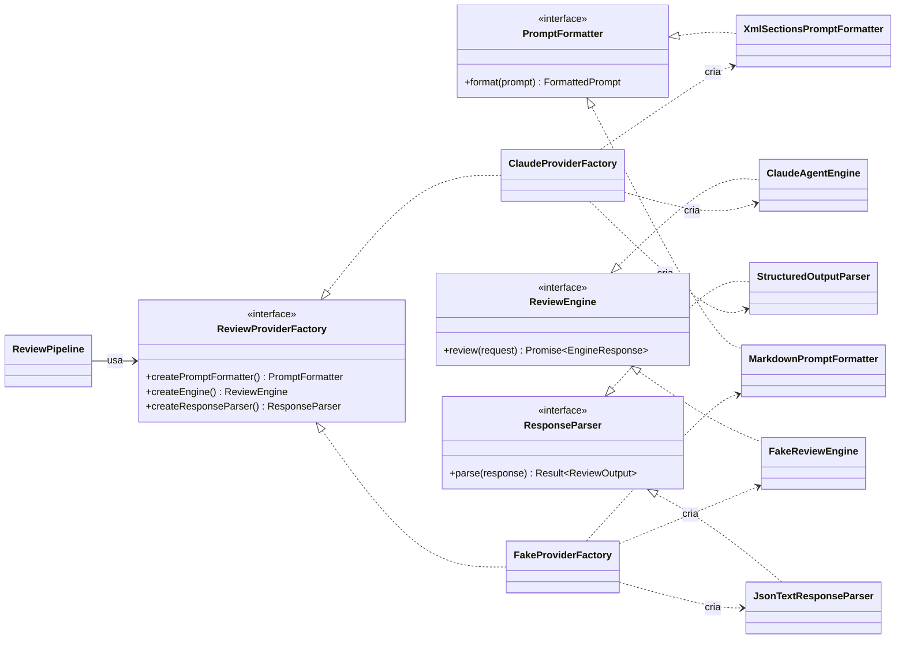
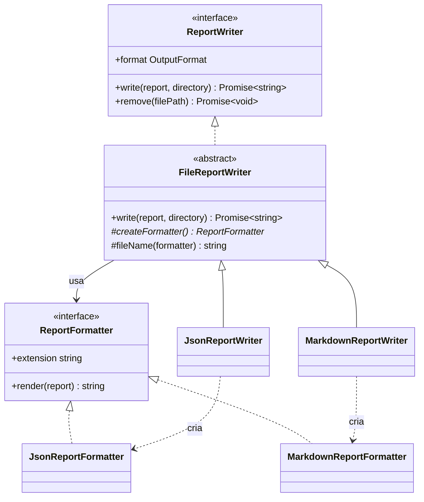
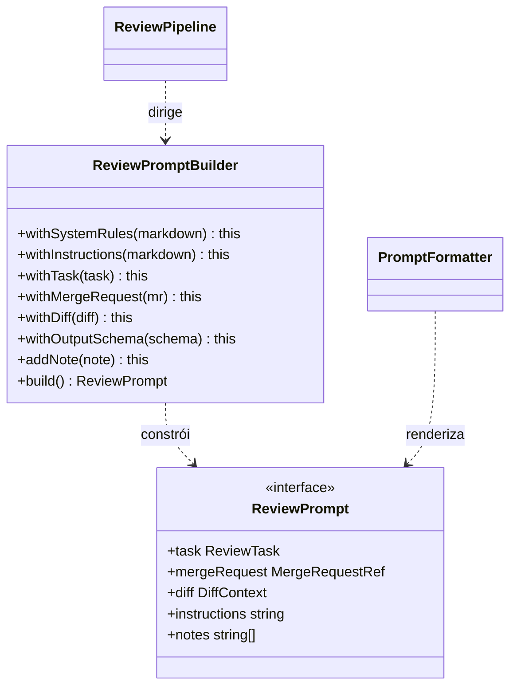
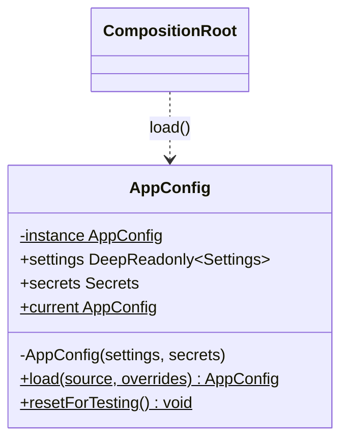
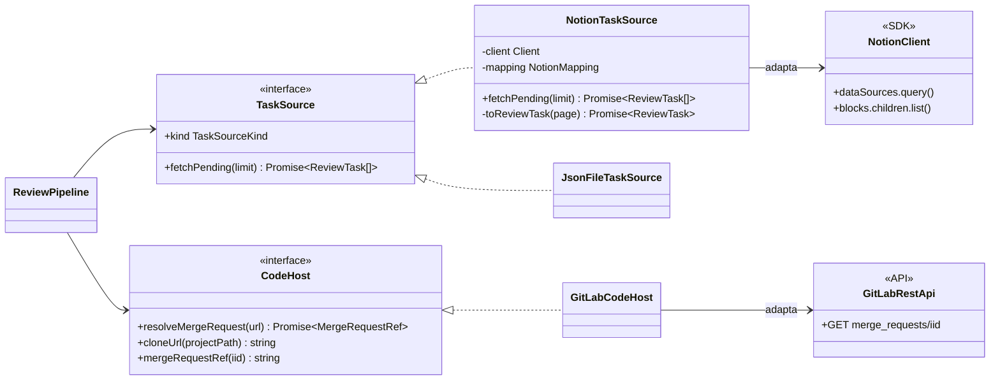
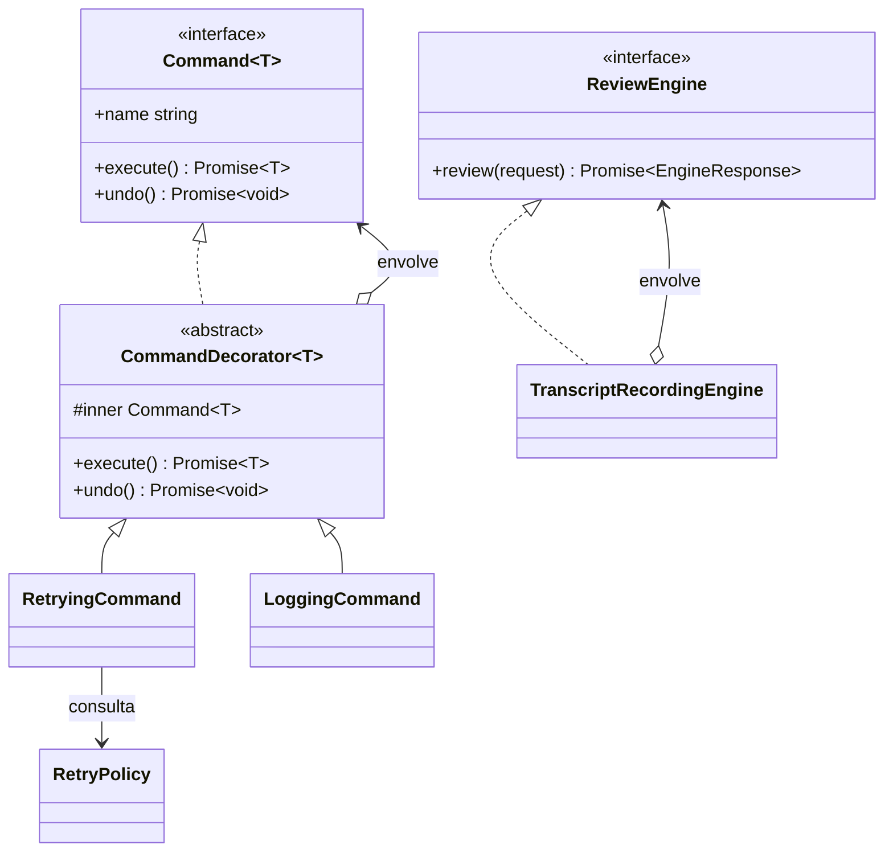
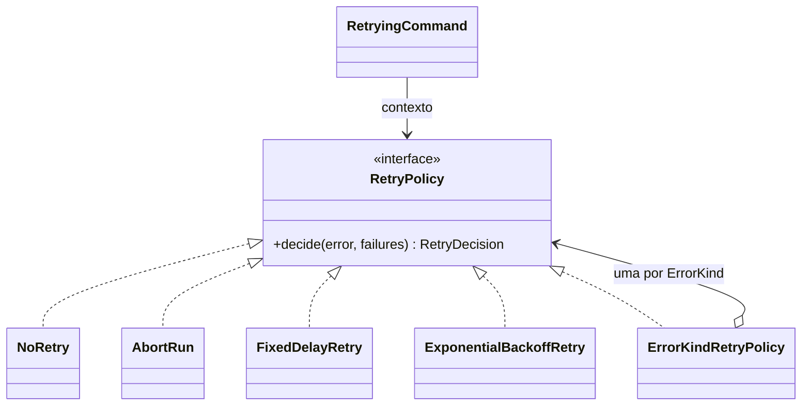
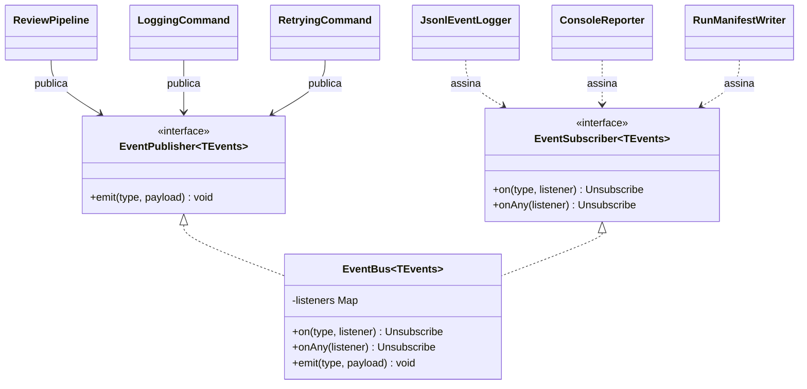
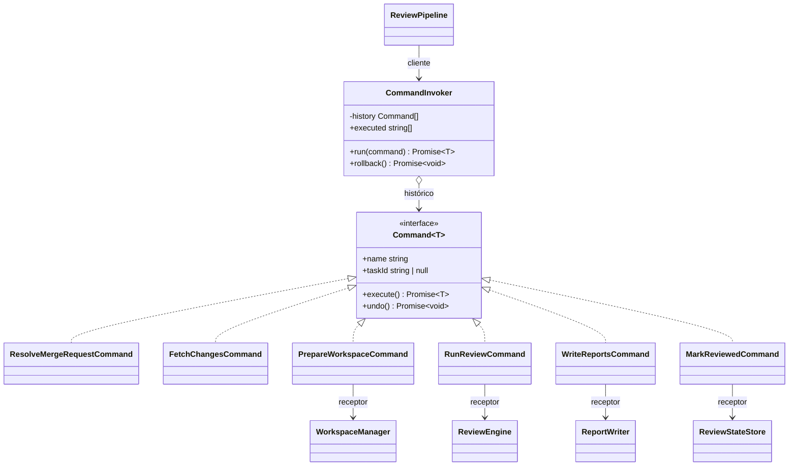

# Padrões de projeto: justificativa

Este documento atende ao requisito de justificativa da disciplina. Para cada padrão, ele explica o problema concreto do sistema, por que o padrão é a escolha certa diante das alternativas, quem faz cada papel, onde está no código e como a execução demonstra o padrão funcionando. A arquitetura completa está em [`ARCHITECTURE.md`](ARCHITECTURE.md).

O nightly-review aplica os **9 padrões** do material, nas três categorias. Nenhum entrou para cumprir tabela: cada um resolve um requisito declarado.

- **Trocar a plataforma de tarefas** (Notion hoje; Jira e Trello depois): Adapter.
- **Trocar a IA:** Abstract Factory.
- **Trocar o formato de saída:** Factory Method.
- **Ter logs de ocorrências, de execução, de erros e de retentativas:** Observer, Decorator, Strategy e Command.
- **Montar um prompt de várias partes:** Builder.
- **Carregar uma configuração única e imutável:** Singleton.

## Resumo

| # | Padrão | Categoria | Problema que resolve | Onde | Demonstração |
|---|---|---|---|---|---|
| 1 | Abstract Factory | Criacional | Formatador, motor e parser de uma IA precisam ser compatíveis entre si | `infrastructure/providers/` | `tests/patterns/abstract-factory.test.ts`, `npm run demo` |
| 2 | Factory Method | Criacional | Cada formato de relatório cria seu formatador; o algoritmo de gravação é o mesmo | `infrastructure/reports/` | `tests/patterns/factory-method.test.ts` |
| 3 | Builder | Criacional | O prompt tem várias partes, algumas opcionais, montadas em etapas | `application/prompt/` | `tests/patterns/builder.test.ts` |
| 4 | Singleton | Criacional | Uma configuração por processo, validada e imutável | `config/app-config.ts` | `tests/patterns/singleton.test.ts` |
| 5 | Adapter | Estrutural | Notion e GitLab têm APIs próprias; o sistema precisa de um modelo único | `infrastructure/task-sources/`, `infrastructure/code-hosts/` | `tests/patterns/adapter.test.ts` |
| 6 | Decorator | Estrutural | Retentativa, log e transcrição valem para qualquer etapa, sem duplicar código | `application/decorators/`, `infrastructure/providers/transcript-recording-engine.ts` | `tests/patterns/decorator.test.ts` |
| 7 | Strategy | Comportamental | A reação a uma falha depende do tipo de erro | `application/retry/` | `tests/patterns/strategy.test.ts` |
| 8 | Observer | Comportamental | O pipeline avisa o que aconteceu sem saber quem registra | `application/events/`, `infrastructure/logging/` | `tests/patterns/observer.test.ts` |
| 9 | Command | Comportamental | Etapas com histórico, retentativa uniforme e rollback | `application/commands/` | `tests/patterns/command.test.ts` |

---

## Criacionais

### 1. Abstract Factory

**Problema.** O review depende de três peças ligadas a um provedor de IA:

- um **formatador** de prompt: o Claude responde melhor a seções delimitadas por tags XML;
- um **motor** que conversa com o provedor: o Agent SDK, com ferramentas de leitura;
- um **parser** que entende a resposta daquele provedor: o campo `structured_output` do SDK.

Misturar peças de provedores diferentes quebra o sistema de formas sutis. Por exemplo, o parser do Claude espera `structured_output`, que outro motor não produz. E o requisito pede outras IAs no futuro.

**Por que este padrão.** A Abstract Factory cria **famílias de objetos relacionados** sem que o cliente conheça as classes concretas. O pipeline pede `createPromptFormatter()`, `createEngine()` e `createResponseParser()` a uma única fábrica e recebe três peças coerentes. Factories isoladas para cada peça não garantiriam a coerência. Um `if (provider === 'claude')` espalhado pelo código seria pior ainda.

**Participantes.**

| Papel GoF | No projeto |
|---|---|
| AbstractFactory | `ReviewProviderFactory` |
| ConcreteFactory | `ClaudeProviderFactory`, `FakeProviderFactory` (e futuramente `OpenAIProviderFactory`) |
| AbstractProduct | `PromptFormatter`, `ReviewEngine`, `ResponseParser` |
| ConcreteProduct | Família Claude: `XmlSectionsPromptFormatter`, `ClaudeAgentEngine`, `StructuredOutputParser`. Família falsa: `MarkdownPromptFormatter`, `FakeReviewEngine`, `JsonTextResponseParser` |
| Client | `ReviewPipeline` |



```ts
export class ClaudeProviderFactory implements ReviewProviderFactory {
  readonly kind = ProviderKind.Claude;

  constructor(private readonly settings: ClaudeEngineSettings) {}

  createPromptFormatter(): PromptFormatter {
    return new XmlSectionsPromptFormatter();
  }

  createEngine(): ReviewEngine {
    return new ClaudeAgentEngine(this.settings);
  }

  createResponseParser(): ResponseParser {
    return new StructuredOutputParser();
  }
}

// No pipeline, a família inteira vem da mesma fábrica:
this.family = {
  formatter: deps.provider.createPromptFormatter(),
  engine: deps.decorateEngine(deps.provider.createEngine()),
  parser: deps.provider.createResponseParser(),
};
```

**Demonstração.** O teste verifica que cada fábrica entrega os três produtos da sua própria família. Depois, executa o review com a família falsa e com a família Claude, esta com o `query()` do SDK simulado por `vi.mock`. A `FakeProviderFactory` não é especulativa: é a segunda família real, usada em todos os testes e na `npm run demo`. Com ela, o sistema roda sem rede e sem credenciais.

**Consequências.**

- **A favor:** trocar de IA é trocar a fábrica na raiz de composição, e o pipeline não muda.
- **Contra:** acrescentar um quarto tipo de produto exige mudar a interface e todas as fábricas. Esse é o custo clássico do padrão, aceitável porque o conjunto de peças de um provedor é estável.

### 2. Factory Method

**Problema.** Todo relatório é gravado do mesmo jeito: monta o caminho, grava de forma atômica e devolve o caminho. Muda só o **formatador** (JSON, Markdown e, no futuro, o formato Code Quality do GitLab). Repetir o algoritmo de gravação em cada formato duplicaria código. Um `switch` por formato precisaria ser editado a cada formato novo.

**Por que este padrão.** No Factory Method, a classe criadora fixa o algoritmo e delega a uma subclasse a decisão de **qual produto criar**. A `FileReportWriter` implementa `write()` e declara `createFormatter()` como abstrato. Cada subclasse decide o formatador e pode também sobrescrever o gancho `fileName()`.

A alternativa seria injetar o formatador por construtor (Strategy). Ela foi preterida porque cada formato é um tipo nomeado de saída, selecionado por `OutputFormat` na configuração, e porque formatos futuros precisam ajustar mais de um ponto do processo. O Code Quality do GitLab, por exemplo, exige um nome fixo de arquivo.

**Participantes.**

| Papel GoF | No projeto |
|---|---|
| Creator | `FileReportWriter` (classe abstrata) |
| ConcreteCreator | `JsonReportWriter`, `MarkdownReportWriter` (futuro: `CodeQualityReportWriter`) |
| Product | `ReportFormatter` |
| ConcreteProduct | `JsonReportFormatter`, `MarkdownReportFormatter` |



```ts
export abstract class FileReportWriter implements ReportWriter {
  abstract readonly format: OutputFormat;

  /** Factory Method. */
  protected abstract createFormatter(): ReportFormatter;

  constructor(private readonly redact: Redactor = (text) => text) {}

  async write(report: ReviewReport, directory: string): Promise<string> {
    const formatter = this.createFormatter();
    const filePath = join(directory, this.fileName(formatter));
    await writeFileAtomic(filePath, this.redact(formatter.render(report)));
    return filePath;
  }

  protected fileName(formatter: ReportFormatter): string {
    return `review${formatter.extension}`;
  }
}

export class MarkdownReportWriter extends FileReportWriter {
  readonly format = OutputFormat.Markdown;

  protected createFormatter(): ReportFormatter {
    return new MarkdownReportFormatter();
  }
}

// A configuração escolhe os formatos sem if/switch:
export const REPORT_WRITERS: Readonly<Record<OutputFormat, (redact?: Redactor) => ReportWriter>> = {
  [OutputFormat.Json]: (redact) => new JsonReportWriter(redact),
  [OutputFormat.Markdown]: (redact) => new MarkdownReportWriter(redact),
};
```

O `redactor` entra pelo construtor porque tudo que vai para disco passa por ele; a raiz de composição o entrega ao criar cada writer.

**Demonstração.** O teste grava o mesmo `ReviewReport` com as duas subclasses numa pasta temporária. Ele confere a extensão, o conteúdo e que `remove()` apaga o arquivo. O `Record<OutputFormat, …>` faz o compilador exigir um writer para cada valor do enum.

**Consequências.**

- **A favor:** um formato novo é uma subclasse nova, sem mexer no código de gravação.
- **Contra:** há uma subclasse por formato, um pequeno aumento de classes.

### 3. Builder

**Problema.** O prompt do review tem sete partes, de origens diferentes:

- as regras do sistema;
- as instruções do time;
- a tarefa do Notion;
- o MR do GitLab;
- o diff do git;
- o schema de saída;
- notas opcionais.

As partes ficam disponíveis em momentos diferentes do pipeline. Um construtor com sete parâmetros seria ilegível e fácil de chamar na ordem errada. Um objeto montado aos poucos e sem validação poderia chegar incompleto ao modelo.

**Por que este padrão.** O Builder separa a **construção passo a passo** da **representação final**. Cada `withX()` registra uma parte e devolve `this`, o que dá uma API fluente. O `build()` valida que nada obrigatório faltou e devolve um `ReviewPrompt` congelado.

O pipeline faz o papel de Director, porque decide a ordem dos passos. O `ReviewPrompt` é neutro: não tem formato. Quem o renderiza é o `PromptFormatter` da família da Abstract Factory. Assim, o mesmo prompt vira XML para o Claude ou Markdown para outro provedor.

**Participantes.**

| Papel GoF | No projeto |
|---|---|
| Builder (concreto) | `ReviewPromptBuilder` |
| Product | `ReviewPrompt` |
| Director | `ReviewPipeline.reviewTask()` |



```ts
build(): ReviewPrompt {
  const { systemRules, instructions, task, mergeRequest, diff, outputSchema } = this;
  if (!systemRules || !instructions || !task || !mergeRequest || !diff || !outputSchema) {
    throw new ConfigurationError('Prompt incompleto', { missing: this.missingParts() });
  }
  if (diff.files.length === 0) {
    throw new InvalidInputError('O MR não tem arquivos alterados', { iid: mergeRequest.iid });
  }
  return Object.freeze({ systemRules, instructions, task, mergeRequest, diff, outputSchema,
    notes: Object.freeze([...this.notes]) });
}
```

**Demonstração.** O teste mostra três comportamentos:

- um `build()` com partes faltando lança um erro que lista o que falta;
- um `build()` completo produz um objeto congelado;
- o mesmo `ReviewPrompt` gera saídas diferentes nos formatadores XML e Markdown.

**Consequências.**

- **A favor:** a montagem fica legível e a validação fica num ponto só.
- **Contra:** a checagem de completude acontece em tempo de execução. Uma variante com genéricos de estado (*type-state builder*) levaria a checagem para a compilação; ela fica registrada como evolução possível.

### 4. Singleton

**Problema.** A configuração (`review.config.json` + variáveis de ambiente) precisa ser lida, validada e congelada **uma única vez** por processo. Ler o arquivo de vários pontos poderia produzir visões diferentes durante uma execução longa e repetiria a validação.

**Por que este padrão, e com quais limites.** O Singleton garante uma única instância com acesso global:

- o construtor é `private`;
- `static load()` cria e valida na primeira chamada e devolve a mesma instância nas seguintes;
- `static current` dá acesso depois do carregamento.

O padrão tem críticas conhecidas: cria estado global e dependências escondidas, e dificulta os testes. Por isso o uso aqui é deliberadamente contido:

- só a **raiz de composição** chama `AppConfig.load()`;
- as demais classes recebem, **por construtor**, apenas o trecho de configuração de que precisam;
- nenhuma classe de domínio ou de aplicação importa `AppConfig`;
- o conteúdo é `DeepReadonly` e congelado em tempo de execução, então o estado global é imutável;
- `resetForTesting()` existe só para os testes do próprio Singleton.

**Participantes.** `AppConfig` faz o papel de Singleton. O cliente único é `composition-root.ts`.



```ts
export class AppConfig {
  private static instance: AppConfig | undefined;

  private constructor(
    readonly settings: DeepReadonly<Settings>,
    readonly secrets: Readonly<Secrets>,
  ) {}

  static load(
    source: ConfigSource = fileConfigSource(),
    overrides: SettingsOverrides = {},
  ): AppConfig {
    if (AppConfig.instance) return AppConfig.instance;
    const settings = applyOverrides(parseSettings(source.readSettings()), overrides);
    const secrets = parseSecrets(source.env, settings);
    AppConfig.instance = new AppConfig(deepFreeze(settings), Object.freeze(secrets));
    return AppConfig.instance;
  }
}
```

`parseSettings` valida com o `SettingsSchema` e lança `ConfigurationError` com `z.prettifyError`. `applyOverrides` aplica as flags da CLI e valida de novo. `parseSecrets` exige só os tokens que a configuração usa.

**Demonstração.** O teste verifica três coisas:

- duas chamadas a `load()` devolvem a mesma instância;
- `current` aponta para ela;
- os objetos aninhados estão congelados (`Object.isFrozen`).

**Consequências.**

- **A favor:** a configuração é consistente e validada uma única vez.
- **Contra:** há estado global. Ele foi mitigado pela imutabilidade e pela injeção por construtor no resto do sistema.

---

## Estruturais

### 5. Adapter

**Problema.** As fontes externas falam línguas diferentes:

- o Notion devolve páginas com propriedades tipadas e blocos de conteúdo;
- o GitLab devolve JSON em `snake_case`, com `diff_refs` às vezes nulo enquanto o diff é calculado;
- no futuro, o Jira devolverá issues com campos personalizados.

O pipeline não pode conhecer nenhum desses formatos, senão cada nova plataforma exigiria mudar o núcleo.

**Por que este padrão.** O Adapter converte a interface de uma classe existente (*Adaptee*) na interface que o cliente espera (*Target*). As portas `TaskSource` e `CodeHost` são os Targets. `NotionTaskSource` envolve o `Client` do `@notionhq/client` e converte cada página em `ReviewTask`. `GitLabCodeHost` envolve a API REST e converte a resposta, validada com Zod, em `MergeRequestRef`. O adapter também é a fronteira de confiança: só ele vê o formato externo e o valida antes de entregá-lo ao resto do sistema.

**Participantes.**

| Papel GoF | No projeto |
|---|---|
| Target | `TaskSource`, `CodeHost`, `ReviewEngine` |
| Adapter | `NotionTaskSource`, `JsonFileTaskSource`, `GitLabCodeHost`, `LocalCodeHost`, `ClaudeAgentEngine` |
| Adaptee | `Client` do `@notionhq/client`, API REST do GitLab, `query()` do Claude Agent SDK |
| Client | `ReviewPipeline` e seus comandos |



```ts
export class NotionTaskSource implements TaskSource {
  readonly kind = TaskSourceKind.Notion;

  constructor(
    private readonly client: Pick<Client, 'dataSources' | 'blocks'>,
    private readonly mapping: NotionMapping,
  ) {}

  async fetchPending(limit: number): Promise<readonly ReviewTask[]> {
    const { statusProperty, statusPropertyType, reviewStatus, dataSourceId } = this.mapping;
    const response = await this.client.dataSources.query({
      data_source_id: dataSourceId,
      filter: { property: statusProperty, [statusPropertyType]: { equals: reviewStatus } },
      page_size: limit,
    });
    const pages = response.results.filter(isFullPage).slice(0, limit);
    return Promise.all(pages.map((page) => this.toReviewTask(page)));
  }
}
```

**Demonstração.** O teste alimenta os adapters com respostas gravadas (`tests/fixtures/notion-page.json`, `gitlab-mr.json`) e compara o resultado com o `ReviewTask` e o `MergeRequestRef` esperados. Ele também verifica que um link de MR de outro host é recusado. O `JsonFileTaskSource` é o segundo adapter real da mesma porta, usado na demonstração.

**Consequências.**

- **A favor:** Jira e Trello entram como novos adapters, sem tocar no pipeline.
- **Contra:** é uma camada a mais de mapeamento por plataforma, mas é justamente onde a diferença entre plataformas deve ficar.

### 6. Decorator

**Problema.** Toda etapa do pipeline precisa de log (início, fim, duração, erro) e de retentativa. O motor de IA precisa ainda gravar prompt e resposta de cada tentativa. Colocar isso dentro de cada comando duplicaria código em oito classes. Uma herança (`LoggedRetryingResolveCommand`…) explodiria em combinações.

**Por que este padrão.** O Decorator acrescenta responsabilidades a um objeto **envolvendo-o** com outro de mesma interface, e as camadas se combinam livremente. `LoggingCommand(RetryingCommand(comando))` loga uma vez a etapa inteira, e as retentativas aparecem como eventos intermediários. O mesmo padrão aparece em outro nível: `TranscriptRecordingEngine` envolve qualquer `ReviewEngine` e funciona com o Claude, com o fake ou com um provedor futuro.

**Participantes.**

| Papel GoF | No projeto |
|---|---|
| Component | `Command<T>`; `ReviewEngine` |
| ConcreteComponent | os oito comandos; `ClaudeAgentEngine`, `FakeReviewEngine` |
| Decorator | `CommandDecorator<T>` (classe abstrata) |
| ConcreteDecorator | `RetryingCommand<T>`, `LoggingCommand<T>`; `TranscriptRecordingEngine` |



```ts
export class RetryingCommand<T> extends CommandDecorator<T> {
  constructor(
    inner: Command<T>,
    private readonly policy: RetryPolicy,
    private readonly events: EventPublisher<PipelineEvents>,
    private readonly sleep: (ms: number) => Promise<unknown> = delay,
  ) {
    super(inner);
  }

  override async execute(): Promise<T> {
    // Conta falhas por tipo: uma falha de rede não consome a cota de "saída inválida".
    const failuresByKind = new Map<ErrorKind, number>();
    for (let attempt = 1; ; attempt += 1) {
      try {
        return await this.inner.execute();
      } catch (thrown) {
        // Uma interrupção já decidida por uma camada interna não é reavaliada.
        if (thrown instanceof RunAbortedError) throw thrown;
        const error = toAppError(thrown);
        const failures = (failuresByKind.get(error.kind) ?? 0) + 1;
        failuresByKind.set(error.kind, failures);
        const decision = this.policy.decide(error, failures);
        if (decision.action === 'abort-run') throw new RunAbortedError(error);
        if (decision.action === 'fail') throw error;
        this.events.emit('retry.scheduled', { command: this.name, taskId: this.taskId, attempt,
          delayMs: decision.delayMs, errorKind: error.kind, message: error.message });
        await this.sleep(decision.delayMs);
      }
    }
  }
}

// Na raiz de composição, uma única função decora qualquer comando:
const decorate: CommandDecoration = (command) =>
  new LoggingCommand(new RetryingCommand(command, retryPolicy, bus), bus);
```

**Demonstração.** O teste usa um comando que falha duas vezes com erro transitório antes de funcionar. Ele confere a sequência de eventos `command.started`, `retry.scheduled`, `retry.scheduled`, `command.succeeded`. A espera é injetada, então o teste não dorme de verdade. No pipeline completo, o `TranscriptRecordingEngine` gera `attempt-1.error.json`, `attempt-2.prompt.md` e os demais arquivos de cada tentativa.

**Consequências.**

- **A favor:** as responsabilidades transversais ficam em um lugar só e se combinam livremente.
- **Contra:** a ordem das camadas importa. `Logging(Retrying(x))` gera um log por etapa, enquanto a ordem inversa geraria um log por tentativa. A raiz de composição fixa essa ordem.

---

## Comportamentais

### 7. Strategy

**Problema.** Cada falha pede uma reação diferente:

- o limite da assinatura deve **parar a execução** e deixar as tarefas para a noite seguinte, porque insistir só gasta tempo;
- uma falha de rede pede espera crescente;
- uma saída fora do schema pede uma nova tentativa imediata;
- um link de MR inválido não deve ser retentado.

Codificar isso com `if`s dentro do decorator de retentativa o tornaria rígido e difícil de testar.

**Por que este padrão.** A Strategy encapsula algoritmos intercambiáveis atrás de uma interface. O `RetryingCommand` (Context) só pergunta `policy.decide(erro, falhas)`. As estratégias concretas são `NoRetry`, `AbortRun`, `FixedDelayRetry` e `ExponentialBackoffRetry`.

`ErrorKindRetryPolicy` é uma estratégia que **escolhe a estratégia** pelo tipo de erro. A tabela é um `Record<ErrorKind, RetryPolicy>`, e o compilador exige uma política para cada tipo: esquecer um tipo novo é erro de compilação.

**Participantes.**

| Papel GoF | No projeto |
|---|---|
| Strategy | `RetryPolicy` |
| ConcreteStrategy | `NoRetry`, `AbortRun`, `FixedDelayRetry`, `ExponentialBackoffRetry`, `ErrorKindRetryPolicy` |
| Context | `RetryingCommand` |



```ts
export type RetryDecision =
  | { readonly action: 'retry'; readonly delayMs: number }
  | { readonly action: 'fail' }
  | { readonly action: 'abort-run' };

export interface RetryPolicy {
  // failures: número de falhas daquele tipo de erro, contando a atual.
  decide(error: AppError, failures: number): RetryDecision;
}

export class ErrorKindRetryPolicy implements RetryPolicy {
  constructor(private readonly byKind: Readonly<Record<ErrorKind, RetryPolicy>>) {}

  decide(error: AppError, failures: number): RetryDecision {
    return this.byKind[error.kind].decide(error, failures);
  }
}

export function defaultRetryPolicies(): Record<ErrorKind, RetryPolicy> {
  return {
    [ErrorKind.RateLimit]: new AbortRun(),
    [ErrorKind.Configuration]: new AbortRun(),
    [ErrorKind.Transient]: new ExponentialBackoffRetry({ maxAttempts: 4, baseDelayMs: 2_000, maxDelayMs: 30_000, jitter: true }),
    [ErrorKind.Timeout]: new FixedDelayRetry(2, 10_000),
    [ErrorKind.InvalidOutput]: new FixedDelayRetry(2, 0),
    [ErrorKind.InvalidInput]: new NoRetry(),
    [ErrorKind.NotFound]: new NoRetry(),
    [ErrorKind.Unknown]: new NoRetry(),
  };
}
```

Nas políticas com limite, `maxAttempts` conta as execuções totais, incluindo a primeira: `FixedDelayRetry(2, …)` retenta a primeira falha e reprova na segunda.

**Demonstração.** O teste usa uma tabela de casos para cada estratégia. Por exemplo, o backoff respeita o `Retry-After` e para no limite de tentativas. Na integração, uma falha `rate-limit` encenada faz o pipeline emitir `run.aborted` e marcar as tarefas restantes como `pending`.

**Consequências.**

- **A favor:** as políticas são testáveis isoladamente e configuráveis por tipo de erro.
- **Contra:** são mais classes do que um `if`, mas cada uma tem poucas linhas e uma única responsabilidade.

### 8. Observer

**Problema.** O requisito pede logs de ocorrências, do que foi executado, de erros e de retentativas, em arquivo. Também é útil ver o progresso no terminal e ter um manifesto por execução. No futuro pode entrar uma notificação no Slack. Se o pipeline chamasse cada um desses destinos diretamente, cada novo destino exigiria mudar o pipeline.

**Por que este padrão.** No Observer, o *Subject* notifica os interessados sem conhecê-los. O `EventBus<PipelineEvents>` é tipado pelo mapa de eventos: em `bus.on('task.failed', ({ error }) => …)`, o compilador já sabe o formato do payload. Um observador que lança exceção é isolado e não derruba o pipeline; o erro vai para o `onListenerError` opcional do construtor, que a raiz de composição liga ao stderr.

Cada observador concreto se inscreve com `attach(subscriber)`, que devolve a função de cancelamento. Ele recebe por construtor o caminho do arquivo, o `runId` e o `redactor`.

**Participantes.**

| Papel GoF | No projeto |
|---|---|
| Subject | `EventBus<TEvents>`, que implementa `EventPublisher` e `EventSubscriber` |
| ConcreteObserver | `JsonlEventLogger` (arquivo), `ConsoleReporter` (terminal), `RunManifestWriter` (manifesto) |
| Quem publica | `ReviewPipeline`, `LoggingCommand`, `RetryingCommand`, `CommandInvoker` |



```ts
export class EventBus<TEvents extends object> implements EventPublisher<TEvents>, EventSubscriber<TEvents> {
  private readonly listeners = new Map<keyof TEvents, Set<Listener<never>>>();
  private readonly anyListeners = new Set<Listener<EventEnvelope<TEvents>>>();

  on<K extends keyof TEvents>(type: K, listener: Listener<TEvents[K]>): Unsubscribe {
    const set = this.listeners.get(type) ?? new Set<Listener<never>>();
    set.add(listener);
    this.listeners.set(type, set);
    return () => {
      set.delete(listener);
    };
  }

  emit<K extends keyof TEvents>(type: K, payload: TEvents[K]): void {
    for (const listener of this.listeners.get(type) ?? []) {
      this.safely(() => (listener as Listener<TEvents[K]>)(payload));
    }
    if (this.anyListeners.size === 0) return;
    const envelope = { type, at: this.now().toISOString(), payload } as EventEnvelope<TEvents>;
    for (const listener of this.anyListeners) this.safely(() => listener(envelope));
  }
}
```

**Demonstração.** O teste verifica três comportamentos:

- um observador recebe só o tipo assinado;
- `onAny` recebe o envelope com o horário;
- cancelar a assinatura funciona, e um observador com erro não impede os demais.

Na execução real, `events.jsonl`, `manifest.json` e as linhas do terminal são produzidos por três observadores diferentes a partir dos mesmos eventos.

**Consequências.**

- **A favor:** um destino novo é um observador novo, e o pipeline não muda.
- **Contra:** o fluxo de controle fica menos explícito, porque quem reage a um evento não aparece no código de quem o emite. O mapa `PipelineEvents` documenta isso num lugar só.

### 9. Command

**Problema.** Uma tarefa passa por até oito etapas. Algumas deixam efeitos que precisam ser desfeitos se uma etapa posterior falhar:

- um worktree criado em disco;
- relatórios gravados pela metade;
- uma marcação de "já revisado".

Todas as etapas também precisam receber retentativa e log da mesma forma, e o histórico do que rodou precisa ficar registrado.

**Por que este padrão.** O Command transforma cada requisição em um objeto, com `execute()` e, quando faz sentido, `undo()`. Isso permite três coisas:

- **tratar todas as etapas de modo uniforme:** o invoker aplica os decorators a qualquer comando;
- **guardar histórico:** a propriedade `executed` lista o que rodou;
- **desfazer em ordem reversa:** `rollback()` desfaz o que já tinha sido feito quando a tarefa falha.

**Participantes.**

| Papel GoF | No projeto |
|---|---|
| Command | `Command<T>` |
| ConcreteCommand | `FetchPendingTasksCommand`, `ResolveMergeRequestCommand`, `FetchChangesCommand`, `PrepareWorkspaceCommand`, `RunReviewCommand`, `WriteReportsCommand`, `MarkReviewedCommand`, `CleanupWorkspaceCommand` |
| Receiver | `TaskSource`, `CodeHost`, `WorkspaceManager`, família da Abstract Factory, `ReportWriter`, `ReviewStateStore` |
| Invoker | `CommandInvoker` |
| Client | `ReviewPipeline` |



```ts
export class CommandInvoker {
  private readonly history: Command<unknown>[] = [];

  constructor(
    private readonly decorate: CommandDecoration,
    private readonly events: EventPublisher<PipelineEvents>,
  ) {}

  async run<T>(command: Command<T>): Promise<T> {
    const result = await this.decorate(command).execute();
    this.history.push(command);
    return result;
  }

  async rollback(): Promise<void> {
    for (let command = this.history.pop(); command; command = this.history.pop()) {
      if (!command.undo) continue;
      try {
        await command.undo();
        this.events.emit('command.undone', { command: command.name, taskId: command.taskId });
      } catch (thrown) {
        this.events.emit('command.undone', { command: command.name, taskId: command.taskId,
          error: toAppError(thrown).toJSON() });
      }
    }
  }
}

export class PrepareWorkspaceCommand implements Command<Workspace> {
  readonly name = 'prepare-workspace';
  private workspace: Workspace | undefined;
  // …
  async undo(): Promise<void> {
    if (!this.workspace) return;
    await this.workspaces.dispose(this.workspace);
    this.workspace = undefined;
  }
}
```

**Demonstração.** O teste executa dois comandos, confere `executed` e mostra que o `rollback()` desfaz na ordem inversa. Na integração, quando o limite da assinatura estoura no `run-review`, o log mostra `command.undone` do `prepare-workspace`: o worktree é removido antes de a execução terminar.

**Consequências.**

- **A favor:** as etapas são uniformes e desacopladas do pipeline, e o rollback é confiável.
- **Contra:** há uma classe por etapa. O ganho em retentativa, log e rollback uniformes compensa.

---

## Como os padrões colaboram em uma execução

1. **Singleton:** a raiz de composição chama `AppConfig.load()`.
2. **Abstract Factory:** a raiz escolhe a `ClaudeProviderFactory`, e o pipeline cria dela a família formatador + motor + parser.
3. **Observer:** o `EventBus` recebe os três observadores (arquivo, terminal e manifesto).
4. **Command + Decorator + Strategy:** cada etapa é um comando, executado pelo `CommandInvoker` e envolvido em `LoggingCommand(RetryingCommand)`, que consulta a `ErrorKindRetryPolicy`.
5. **Adapter:** o `NotionTaskSource` entrega `ReviewTask[]`, e o `GitLabCodeHost` entrega `MergeRequestRef`.
6. **Builder:** o `ReviewPromptBuilder` monta o `ReviewPrompt` neutro, que o formatador da família renderiza.
7. **Decorator (de novo):** o `TranscriptRecordingEngine` grava cada tentativa do motor.
8. **Factory Method:** `JsonReportWriter` e `MarkdownReportWriter` gravam os relatórios.
9. **Observer:** cada passo acima emitiu eventos, que viraram `events.jsonl`, `manifest.json` e as linhas do terminal.

## Recursos da linguagem

| Recurso | Onde | Para quê |
|---|---|---|
| `interface` | Portas (`TaskSource`, `CodeHost`, `ReviewEngine`…), `Command<T>`, `RetryPolicy` | Contratos entre camadas e polimorfismo. |
| Classe abstrata | `AppError`, `CommandDecorator<T>`, `FileReportWriter` | Comportamento comum + membros abstratos (`kind`, `createFormatter`). |
| `enum` (string) | `Severity`, `ErrorKind`, `SkipReason`, `ProviderKind`, `OutputFormat`… | Valores fechados e serializáveis; chaves de `Record` exaustivo. |
| Genéricos | `Command<T>`, `CommandInvoker.run<T>`, `EventBus<TEvents>`, `Result<T, E>`, `CommandDecoration` (tipo de função genérica) | O tipo do resultado atravessa decorators e invoker sem conversões. |
| Tipos utilitários | `Readonly`, `Record<ErrorKind, RetryPolicy>`, `Pick<ReviewTask, …>`, `Partial<…>` nos overrides da CLI | Exaustividade, imutabilidade e recortes do modelo. |
| Tipos mapeados e condicionais | `DeepReadonly<T>`, `EventEnvelope<TEvents>` | Imutabilidade profunda; união de envelopes derivada do mapa de eventos. |
| Uniões discriminadas | `RetryDecision`, `TaskOutcome`, `acceptanceCriteria` e `taskSource` na configuração | Estados explícitos verificados pelo compilador. |
| `keyof` e acesso indexado | `on<K extends keyof TEvents>`, `TaskOutcome['status']`, `SDKResultError['subtype']` | Payload certo para cada tipo de evento. |
| Type guards | `isReadOnlyTool(name): name is ReadOnlyTool`, `isFullPage` | Estreitamento seguro de entrada externa. |
| `as const` + `typeof` | `READ_ONLY_TOOLS` e `ReadOnlyTool = (typeof READ_ONLY_TOOLS)[number]` | Lista e tipo vindos da mesma fonte. |
| `never` | `assertNever` em `switch` sobre enums | O compilador acusa o caso esquecido. |
| Modificadores | `readonly`, `private constructor`, `protected abstract`, `override`, *parameter properties* | Imutabilidade, Singleton, Factory Method e sobrescrita explícita. |
| `this` polimórfico | `ReviewPromptBuilder.withX(): this` | API fluente que continua correta em subclasses. |
| `z.infer` | `ReviewOutput`, `Settings` | O tipo é derivado do schema de validação, sem duplicação. |

## Perguntas prováveis na apresentação

**"Por que Factory Method e não Strategy nos relatórios?"** Cada formato é um tipo nomeado de saída, com um algoritmo de gravação comum e ganchos que formatos futuros precisam sobrescrever, como o nome do arquivo. A escolha do formatador pertence ao tipo de writer, e não a quem o usa. Com Strategy, o formatador seria injetado, e quem monta o writer teria de saber combinar formatador e nome de arquivo.

**"O Singleton não é um antipadrão?"** Ele é criticado pelo estado global e pelas dependências escondidas. Aqui o estado é imutável, só a raiz de composição acessa o Singleton, e o resto do sistema recebe configuração por construtor. O padrão foi usado onde o problema pede uma instância única, com os efeitos colaterais contidos.

**"Abstract Factory com uma única IA real não é especulação?"** Há duas famílias em uso hoje: a do Claude e a falsa, que roda nos testes e na demonstração. E outras IAs são um requisito declarado do projeto.

**"Qual a diferença entre o Decorator e um Proxy aqui?"** O Proxy controla o acesso a um objeto. O Decorator acrescenta responsabilidades e é feito para ser empilhado. Retentativa, log e transcrição são responsabilidades novas, combinadas em camadas.

**"Para que `undo` em um pipeline que só lê?"** O pipeline lê o código, mas cria efeitos locais: worktree em disco, relatórios e estado de idempotência. O rollback garante que uma falha no meio não deixe lixo nem marque como revisado algo que não foi.
